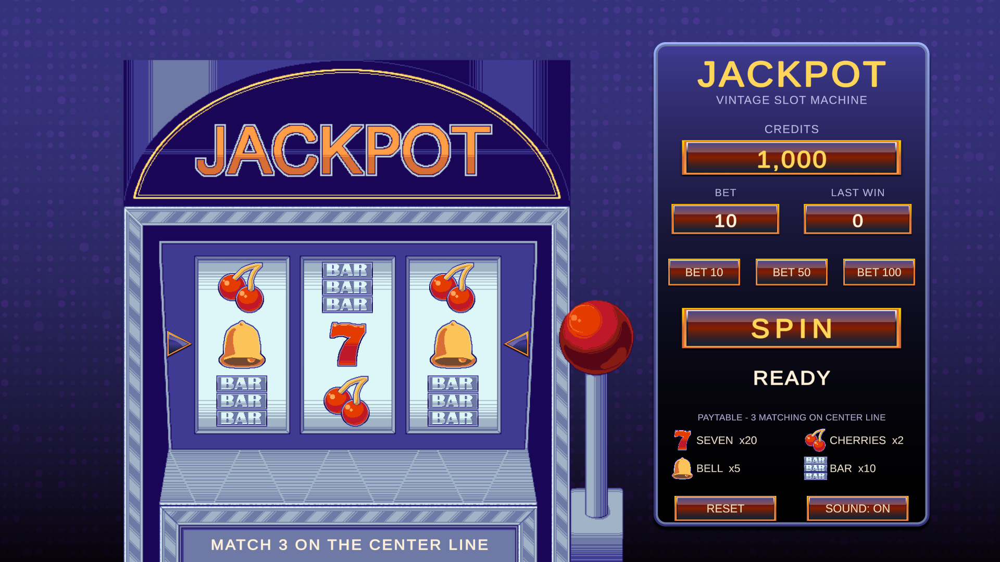
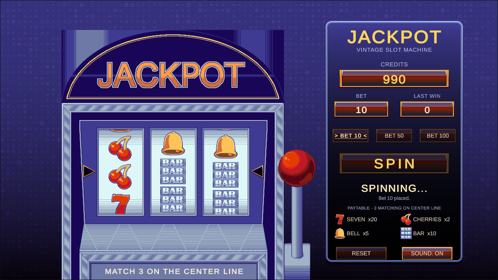
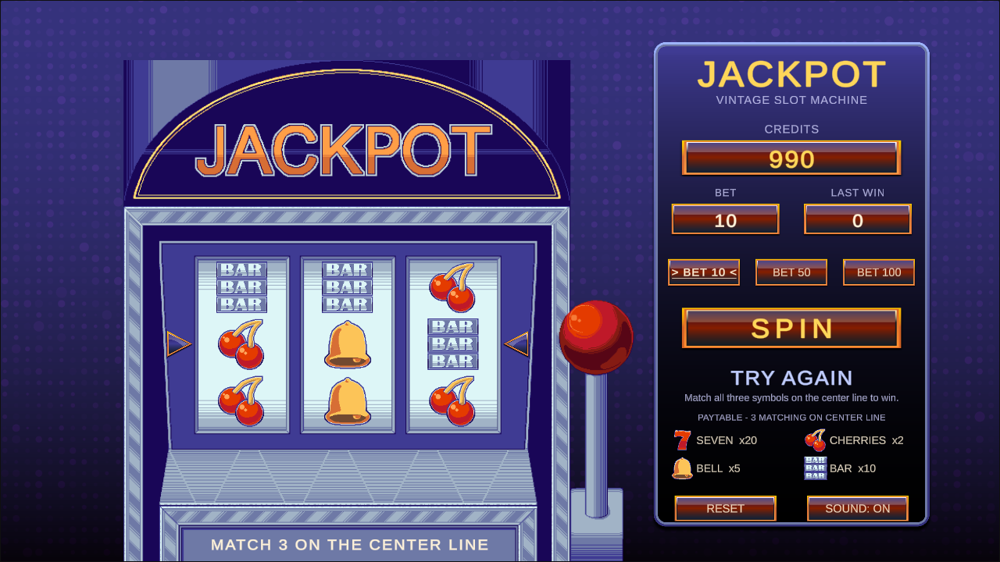

# Jackpot: Vintage 2D Slot Machine (Unity)

A playable 3-reel slot machine made in Unity 6 with C#. It uses the supplied assignment artwork.
Every spin's outcome comes from a weighted RNG **before** the reels move. The reels then animate
smoothly and stop on that outcome. A spin pays out when all three center-row symbols match.

> Virtual credits only. There are no payments or cash-out, and no real-money gambling.



*Rendered from the actual scene by `Tools ▸ Slot Machine ▸ Capture Layout Screenshots`.*

| Web build, mid-spin | Web build, after the stop |
|---|---|
|  |  |

*Gameplay GIF: TODO, record one from the Web build.*

---

## Contents
1. [How to play](#how-to-play)
2. [Rules & payouts](#rules--payouts)
3. [Technology](#technology)
4. [Project structure](#project-structure)
5. [Opening the project](#opening-the-project)
6. [Running the Web build](#running-the-web-build)
7. [Architecture & approach](#architecture--approach)
8. [Testing](#testing)
9. [Bonus features](#bonus-features)
10. [Known limitations](#known-limitations)
11. [Credits](#credits)

---

## How to play

| Control | Action |
|---|---|
| **SPIN** button, the **lever**, or <kbd>Space</kbd> | Spin (all three use the same validated spin path) |
| **BET 10 / BET 50 / BET 100** | Choose the bet (only while idle) |
| **RESET** → **YES / NO / ✕** | Restore 1,000 credits and a bet of 10 (only while idle; asks to confirm) |
| **SOUND: ON/OFF** | Mute / unmute sound effects |

The status line shows `READY`, `SPINNING...`, `YOU WIN <amount>!`, `TRY AGAIN` or
`INSUFFICIENT CREDITS`, with a detail line underneath. The payline arrows blink on a win, and
the winning symbols pulse. Results are shown in text as well as colour.

## Rules & payouts

- 3 reels × 3 visible rows. **The only payline is the middle row.**
- **Win:** `reel 1 center == reel 2 center == reel 3 center`. The top and bottom rows are decorative.
- **Payout:** `bet × multiplier`. The bet is deducted once when the spin starts. A win credits the payout once after all reels stop.
  Example: 1,000 credits, bet 10, 7-7-7 → 1,000 − 10 + 200 = **1,190**.
- Starting balance 1,000. The balance can never go negative, and you can't spin with less than the selected bet.

| Symbol | Art | Weight | Chance per reel | Pays (3 on line) |
|---|---|---:|---:|---:|
| Seven | `slot-symbol1.png` | 10 | 13.3 % | **20×** bet |
| BAR | `slot-symbol4.png` | 15 | 20.0 % | **10×** bet |
| Bell | `slot-symbol3.png` | 20 | 26.7 % | **5×** bet |
| Cherries | `slot-symbol2.png` | 30 | 40.0 % | **2×** bet |

**These weights and multipliers are demonstration values**, not part of the assignment. With them,
about 9.3 % of spins win and the theoretical return is about 35 % of the amount wagered.
They live in `Assets/Settings/Symbols/*.asset`; edit them in the Inspector, no code changes needed.
Timing, bet options and starting credits are in `Assets/Settings/SlotMachineSettings.asset`.

## Technology

| | |
|---|---|
| Engine | **Unity 6000.6.10f1** (Unity 6). Built-in render pipeline, 2D |
| Language | C# (no third-party packages, no DOTween) |
| UI | uGUI Canvas + TextMeshPro (`com.unity.ugui` 2.6) |
| Tests | Unity Test Framework 1.8 (NUnit) |
| Target | Web (WebAssembly), output in `Build/WebGL/` |
| Reference resolution | 1920 × 1080 landscape, `CanvasScaler` *Expand* so 4:3 to 21:9 all fit |

*The brief suggested Unity 6.3 LTS. This project was created with the Unity 6 editor installed on
the development machine (6000.6.10f1). Open it with that version or a newer Unity 6 release.*

## Project structure

```
UnitySlotGame/
├─ Assets/
│  ├─ Art/Provided/Slot Machine/   supplied artwork (unchanged files)
│  ├─ Editor/                      setup tools: import/slicing, scene builder, Web build, screenshots
│  ├─ Scenes/MainGame.unity
│  ├─ Scripts/
│  │  ├─ Core/       GameState, SlotMachineController
│  │  ├─ Data/       SymbolData, SymbolDatabase, SlotMachineSettings (ScriptableObjects)
│  │  ├─ Gameplay/   RNGService, IRandomProvider, UnityRandomProvider, PayoutCalculator,
│  │  │              BalanceManager, BetSelector, ReelController, ReelMotionProfile
│  │  ├─ UI/         UIManager, SlotButtonBindings, LeverController, PaylineMarker
│  │  └─ Audio/      AudioManager
│  ├─ Settings/      SymbolDatabase, SlotMachineSettings, Symbols/*.asset
│  ├─ Tests/EditMode | PlayMode
│  ├─ TextMesh Pro/  TMP Essential Resources
│  └─ WebGLTemplates/Responsive/   letter-boxed 16:9 page with a loading bar
├─ Build/WebGL/      production Web build
├─ Documentation/    GameDesign.md, EditorSetup.md, Screenshots/, Reference/ (supplied GIF)
├─ Packages/  ProjectSettings/
└─ README.md
```

## Opening the project

1. Install **Unity 6000.6.10f1** (or a newer Unity 6) via Unity Hub, with **Web Build Support**.
2. Unity Hub → **Add ▸ Add project from disk** → choose the `UnitySlotGame` folder.
3. Open `Assets/Scenes/MainGame.unity` and press **Play**.

Everything is already generated and committed. To regenerate the import settings, data assets or
scene, use **Tools ▸ Slot Machine** (see [Documentation/EditorSetup.md](Documentation/EditorSetup.md)).

## Running the Web build

Browsers block Unity Web builds opened straight from disk (`file://`), so serve the folder over HTTP:

```bash
cd Build/WebGL
python -m http.server 8000        # or: npx http-server -p 8000
# open http://localhost:8000
```

- Compression is **Gzip with decompression fallback**, so the build runs on any static host
  (GitHub Pages, itch.io, `python -m http.server`) without special `Content-Encoding` headers.
- To rebuild: **Tools ▸ Slot Machine ▸ 4. Build Web (Production)**, or use the command line in `Documentation/EditorSetup.md`.
- GitHub Pages: publish the contents of `Build/WebGL/` (for example, from a `gh-pages` branch).

## Architecture & approach

The main goal was to keep **rules, randomness, animation and presentation separate**. That keeps
each part small and lets the rules be tested without Play Mode.

```
Button/Lever/Space ─► SlotButtonBindings ─► SlotMachineController (state machine)
                                              │  BalanceManager   debit once / credit once / refund
                                              │  BetSelector      10 / 50 / 100
                                              │  RNGService ◄──── IRandomProvider (Unity RNG, or a fake in tests)
                                              │  PayoutCalculator center-row rule
                                              ├─► ReelController ×3 ◄─ ReelMotionProfile
                                              ├─► UIManager / PaylineMarker / LeverController
                                              └─► AudioManager
```

**Key decisions**

- **Outcome first, animation second.** `TrySpin` debits the bet and draws all 9 visible symbols
  before anything moves. Each reel gets a plan and animates to it, so timing can't change the result.
  Each reel and the controller both check that the displayed center row equals the plan before
  any payout.
- **Exact stops.** `ReelMotionProfile` (ease-in → cruise → ease-out with a small bounce) slightly
  adjusts the cruise speed so the reel travels a whole number of cells. The final frame is
  snapped to an exact cell position with no fractional offset.
- **No allocations while spinning.** Each reel reuses a pool of 5 `Image` cells (1 hidden above, 3 visible,
  1 hidden below) inside a `RectMask2D`. The strip scrolls one cell, snaps back, and the sprites
  shift along a pre-built "tape". No Instantiate or Destroy, and no per-frame LINQ or strings.
- **State machine** `Ready → Spinning → Evaluating → Winning/Losing → Ready`. Input is ignored
  outside `Ready`, which blocks double spins, double debits and double payouts. If a reel fails
  or times out (watchdog), the bet is refunded, no payout is made, and the game returns to `Ready`.
- **Data-driven.** Symbols, weights, multipliers, bets, credits and timings are ScriptableObjects.
  Everything is validated at start-up, and any configuration errors are logged.
- **Fair, testable RNG.** `RNGService` does weighted selection over `[0, totalWeight)` through
  `IRandomProvider`. Production uses `UnityEngine.Random`; tests inject scripted or seeded providers.
  No forced wins and no balance-dependent odds. *Unity's RNG is fine for virtual credits, but it is
  not cryptographically secure.*
- **Reproducible scene.** The scene is built by an editor script from measured artwork coordinates.
  The reel windows were measured from the alpha channel of `slot-machine4.png`. That makes the layout exact and easy to
  regenerate, and the result is a normal scene that can still be edited by hand.

More detail is in [Documentation/GameDesign.md](Documentation/GameDesign.md).

## Testing

Run in **Window ▸ General ▸ Test Runner**, or from the command line (see `Documentation/EditorSetup.md`).

| Suite | Tests | Covers |
|---|---:|---|
| `PayoutCalculatorTests` | 13 | each symbol's multiplier, mismatches, null/wrong-count rows, zero/negative bet, null symbol, overflow |
| `RNGServiceTests` | 18 | empty/null/invalid entries, every weighted interval boundary, out-of-range rolls, never outside DB, probabilities |
| `BalanceManagerTests` | 14 | start, single debit, insufficient funds, zero/negative bets, payout, clamp, refund, reset, never negative |
| `BetSelectorTests`, `ReelMotionProfileTests` | 9 | bet selection; whole-cell stops, continuity, overshoot below one cell |
| `ProbabilitySimulationTests` | 2 | 200,000 seeded draws within 5σ of configured weights; Unity RNG produces every symbol |
| **PlayMode** `SlotMachinePlayModeTests` | 4 | real scene and animation: forced win pays once (1,190), forced loss pays 0, extra input mid-spin ignored, reset ignored mid-spin, reels stop on planned symbols |

**Results on the development machine (Unity 6000.6.10f1, Windows 11):** Edit Mode 56/56 passed and
Play Mode 4/4 passed. The layout was checked with rendered screenshots at 1920×1080, 1366×768
and 1280×960 (in `Documentation/Screenshots/`).

**Automated browser smoke test (headless Chrome, served over local HTTP):** the production build
loaded in about 3 s with no console errors or exceptions. Clicking SPIN debited the bet
(1,000 → 990), the reels visibly scrolled inside the windows with the controls disabled, the reels
stopped on the cell grid with the result shown, and the BET 50 button updated the bet.
The screenshots above come from that run.

Manual browser QA: TODO. Play the build in Chrome and Edge, and check sound, the lever, the reset popup and a win.

## Bonus features

- Lever pull (the supplied up/pulled sprites), plus the Space key
- Reset confirmation popup using the supplied popup, YES/NO and close-button sprite sheets (sprite-swap states)
- Payline arrows (from the supplied arrow sheets) that blink on a win, and winning symbols that pulse
- In-game paytable
- Sound effects with a mute toggle. No audio was supplied, so short tones are generated in code; you can assign real clips on the `Audio` object
- Responsive Web page template (letter-boxed 16:9 with a loading bar)
- Stop bounce and staggered reel stops (0.38 s apart)

## Known limitations

- Single payline (middle row) by design. Diagonals and other lines are not implemented.
- Credits are not saved between sessions.
- Sound effects are simple synthesized tones because no audio assets were supplied.
- `slot-machine1.png` (cabinet with filled windows) is imported but not used: the scene uses
  `slot-machine4.png` + `slot-machine5.png`, so the reels can sit between them.
- With the demonstration odds, credits run down over time (about a 35 % return). Retune the weights
  and multipliers in the symbol assets for a different feel.
- Unity's RNG is not cryptographically secure. This is fine for this offline demo, but it is not suitable for real money.

## Credits

- All artwork (cabinet, lever, symbols, buttons, popup, background and the reference GIF) was **supplied
  with the assignment** (`Slot Machine.zip`) and is used unmodified.
- Fonts: Liberation Sans via TextMeshPro Essential Resources (Unity).
- Code: written for this assignment.
